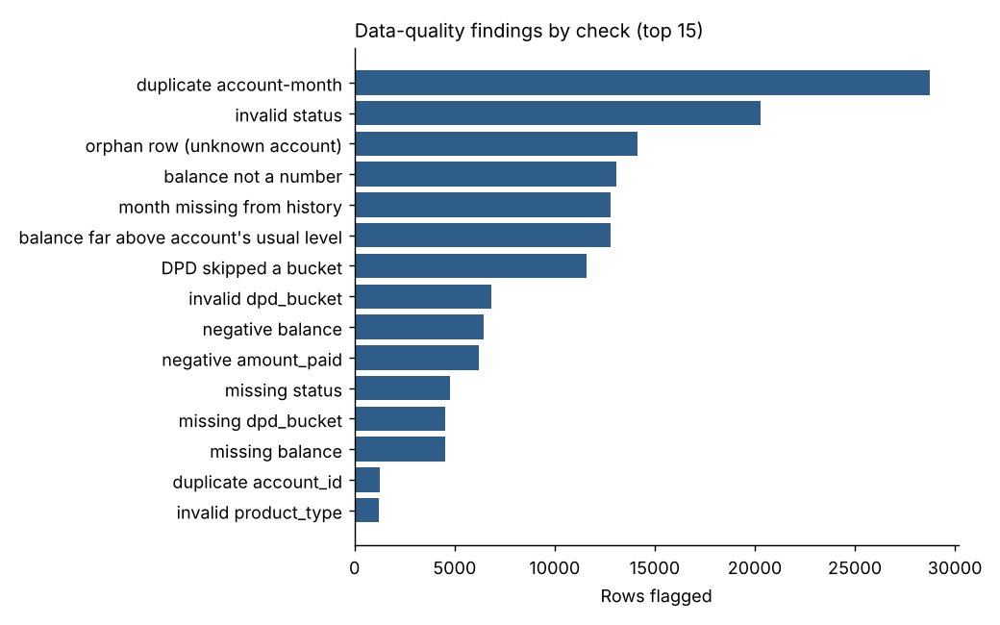
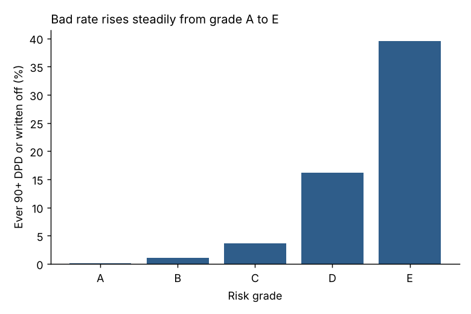
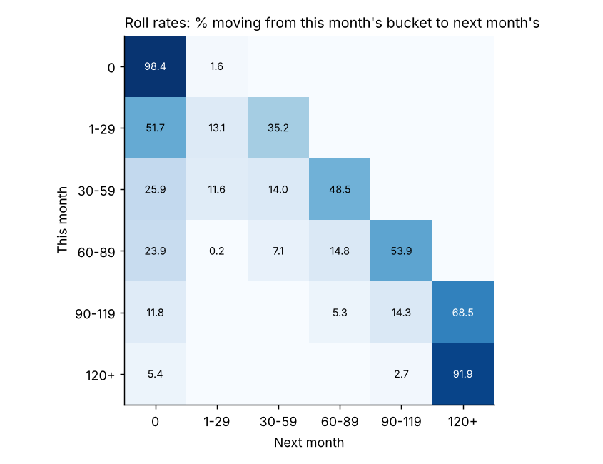
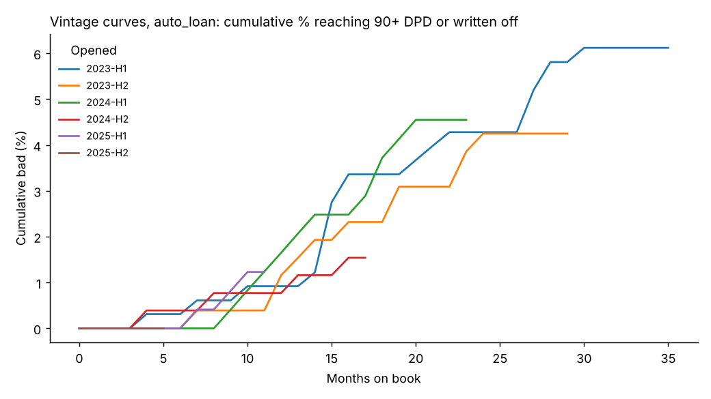
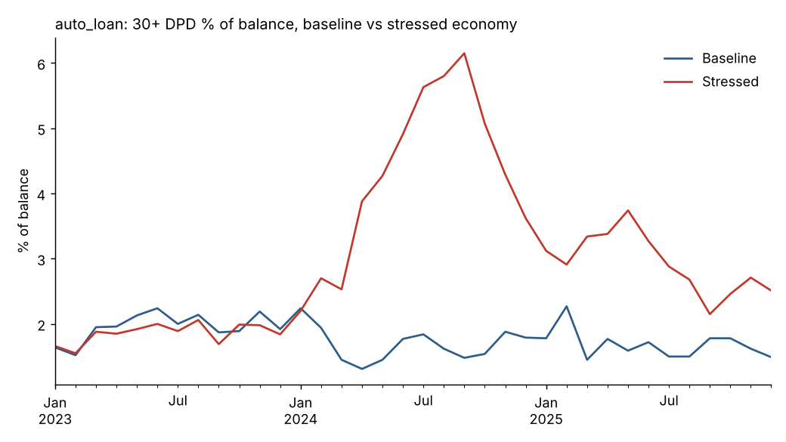

# Credit portfolio data pipeline

A Python pipeline that takes loan-level credit data, checks it for errors, cleans it, and turns it into the portfolio analysis an investor or lender would ask for: arrears, write-offs, risk by grade, roll rates, vintage curves and a stress test.

The data is synthetic credit bureau data from [creforge](https://github.com/chowkuanlaw/creforge), consisting of 20,000 borrowers, about 64,000 accounts across six products, and 36 months of payment history (1.4 million monthly rows). creforge can also corrupt a copy of the data with 16 kinds of realistic fault and keep an answer key, so the data-quality checks can be **scored**.

## Results

| | |
|---|---|
| Faults injected by creforge | 155,554 |
| Caught by the checks (recall) | **98.3%** overall, **99.7%** on the three tables the pipeline reads |
| Findings that were real faults (precision) | **99.9%** |
| False alarms on clean data | None from rule-based checks; about 120 of 1.4m rows from outlier checks |



Bad rates rise steadily with the borrower's risk grade, from 0.15% at grade A to about 39% at grade E:







Under creforge's stressed economy, peak 30+ days past due on auto loans rises from 2.3% to 6.2% of balance:



## How it works

`pipeline.py` has five stages:

1. **Load:** read every CSV as text, so a stray "N/A" or a date written 31/01/2024 is caught rather than silently misread.
2. **Validate:** about 30 checks across five families:
   - uniqueness (duplicate accounts and months)
   - completeness (required fields)
   - validity (allowed codes, real dates, numbers, no negatives)
   - consistency (DPD can only worsen one bucket a month, no payment in a month the account rolls worse, nothing after a write-off, close reason matches the final status)
   - distribution (values 20x above normal, to catch x100 errors)
3. **Clean:** rescue what is safe to rescue (code formatting, UK-format dates). Remove what isn't, and log every step. Suspicious values are never "fixed" by guessing.
4. **Summarise:** portfolio by product, 12-month write-off rates, bad rate by risk grade, 30+ DPD trend, roll-rate matrix and vintage curves.
5. **Report:** an Excel workbook (one sheet per table), a findings list for the servicer, and charts.

## Run it

```bash
pip install -r requirements.txt
creforge generate --subjects 20000 --months 36 --seed 42 --format csv --money float --out clean
creforge inject clean --faults standard --seed 7 --format csv --out dirty
python -c "from pipeline import run; run('dirty', 'output')"
creforge score dirty/faults.parquet output/findings.csv
```

The same seed always gives the same data, so the results above reproduce exactly.

## Limitations

- **Small x100 errors can slip through.** A small balance multiplied by 100 can still look normal, so outlier checks miss some scale errors and flag a few genuine large values.
- **Duplicates are resolved by keeping the first row.** With real data the servicer would be asked which row is correct.
- **The vintage curves are noisy.** Each half-year vintage has about 250 auto loans.
- **The data is synthetic.** creforge's parameters are illustrative, not fitted to any real lender.

Sample output: [`sample_report.xlsx`](sample_report.xlsx)
